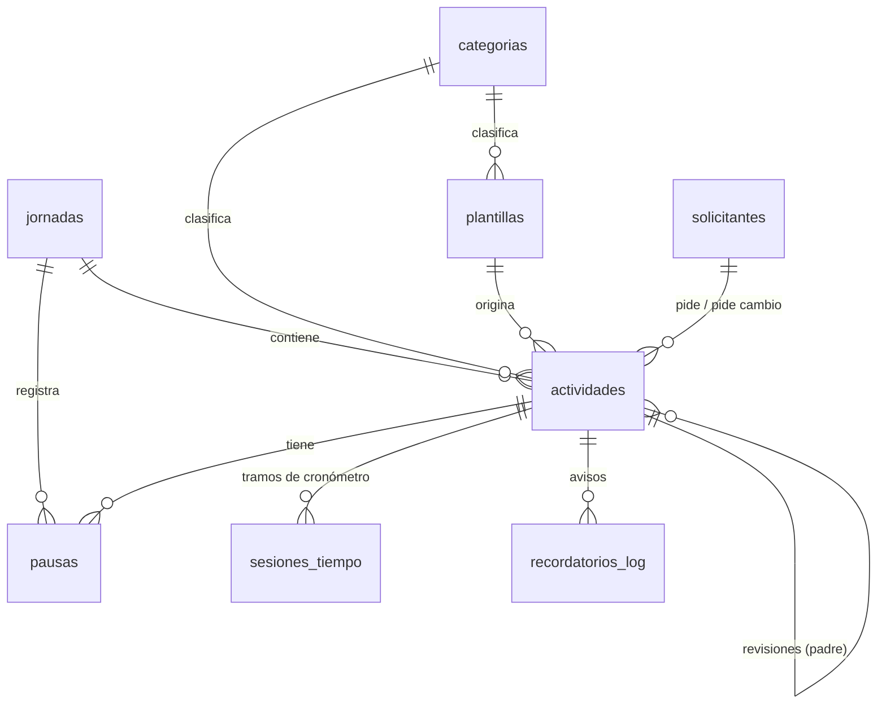

# Documentación técnica

> Se actualiza al terminar cada fase.

## 1. Arquitectura

```
Interfaz (src/ui)          PySide6
   │
Servicios (src/services)   lógica de negocio (desde la Fase 2)
   │
Repositorios (src/data/repositorios)
   │
Modelos + BD (src/data)    SQLAlchemy 2 + SQLite (WAL) + Alembic
```

La capa de interfaz nunca accede a SQLite directamente: usa servicios, y estos
usan repositorios y modelos.

## 2. Arranque

`src/main.py`:
1. Configura el log rotativo en `%LOCALAPPDATA%\ControlTiempos\logs\app.log`.
2. `BaseDatos.abrir()` → crea el archivo si no existe, aplica migraciones de
   Alembic pendientes y carga los datos iniciales que falten.
3. Abre la ventana principal (o, con `--verificar`, imprime el estado de la BD).

## 3. Módulos

| Módulo | Responsabilidad |
|---|---|
| `config/rutas.py` | Nombre, versión, carpetas de datos, logs y copias |
| `data/tiempo.py` | `ahora()`: hora local sin zona (única fuente de la hora actual) |
| `data/enums.py` | Valores permitidos de los campos de texto y sus etiquetas |
| `data/models.py` | Modelos SQLAlchemy y restricciones `CHECK` |
| `data/db.py` | Motor, pragmas de SQLite, migraciones, `BaseDatos.sesion()` |
| `data/semilla.py` | Horario, solicitantes y configuración por defecto |
| `data/migrations/` | Entorno y versiones de Alembic |
| `data/repositorios/configuracion.py` | `RepoConfiguracion`: lectura/escritura tipada |
| `data/repositorios/horarios.py` | `RepoHorarios`: bloques, día laboral, duración de jornada, en horario |
| `data/repositorios/catalogos.py` | `RepoCategorias`, `RepoSolicitantes`, `RepoPlantillas` |
| `data/repositorios/jornadas.py` | `RepoJornadas`: apertura automática de jornada laboral o no laboral |
| `services/numeracion.py` | Numeración consecutiva de piezas (`Flyer 1` → `Flyer 2`) y lotes |
| `services/actividades.py` | `ServicioActividades`: planeadas, lotes, plantillas, extras, aprobaciones, revisiones, desglose y correcciones con trazabilidad |
| `services/cronometro.py` | `ServicioCronometro`: iniciar, pausar, reanudar, finalizar, "finalizar y empezar siguiente", reasignar y partición automática dentro/fuera de horario |
| `services/recordatorios.py` | `ServicioRecordatorios`: avisos de continuidad (`¿Sigues con...?`), repetición sin respuesta, finalización, sin actividad en curso, almuerzo y salida |
| `services/inicio_windows.py` | `ServicioInicioWindows`: inicio automático en `HKCU\...\Run` con `--bandeja` sin permisos de administrador |
| `services/productividad.py` | `ServicioProductividad`: fórmula 40/30/30, reglas especiales, semáforo, meta de tiempo efectivo y datos de referencia |
| `services/backups.py` | `ServicioBackups`: copias automáticas con rotación, copia a USB/carpeta y restauración con `PRAGMA integrity_check` |
| `services/whatsapp.py` | `ServicioWhatsApp`: textos listos para "Copiar plan para WhatsApp" y "Copiar resumen para WhatsApp" |
| `services/cierre_jornada.py` | `ServicioCierreJornada`: asistente de cierre de actividades abiertas, cálculo del día y backup automático |
| `services/seguridad_pin.py` | `ServicioPIN`: hash PBKDF2-HMAC-SHA256 y verificación del PIN opcional |
| `services/historial.py` | `ServicioHistorial`: consulta por rangos (día, semana, mes), filtros combinados y detalle con trazabilidad |
| `services/estadisticas.py` | `ServicioEstadisticas`: tendencia (día/semana/mes), tiempo por categoría, estimado vs. real, por solicitante y revisiones por motivo |
| `reports/generador_pdf.py` | Renderizado HTML/CSS a PDF A4 con `QPdfWriter` + `QTextDocument` y plantillas de los 4 tipos de reporte |
| `services/reportes_pdf.py` | `ServicioReportesPDF`: exportación de reporte diario, día no laboral, específico y semanal/mensual |
| `ui/temas.py` | `generar_qss`: temas Claro, Oscuro y Azul Pizarra |
| `ui/mini_widget.py` | `MiniWidgetCronometro`: ventana flotante siempre encima con controles en 1 clic |
| `ui/dialogos.py` | Diálogos para PIN, pausa, revisión, reasignación, corrección con motivo y decisión del ingeniero |
| `ui/pantallas/` | `PantallaHoy`, `PantallaPlanear`, `PantallaExtra`, `PantallaCierre`, `PantallaHistorial`, `PantallaEstadisticas`, `PantallaReportes`, `PantallaConfiguracion` |
| `ui/ventana_principal.py` | `VentanaPrincipal`: navegación lateral, atajos de teclado y reloj en vivo |
| `ui/dialogo_recordatorio.py` | `DialogoRecordatorio`: ventana emergente al frente con botones Sí / No / Pausar y ajuste de minutos |
| `ui/bandeja.py` | `IconoBandeja` (`QSystemTrayIcon`) y `CoordinadorRecordatoriosUI` (`QTimer`) |
| `ui/sonido.py` | `reproducir_tono_aviso`: tono local sin depender de internet |

## 4. Modelo de datos

Basado en la sección 9 del plan, con los ajustes D-05 y D-06 (ver
[decisiones](decisiones.md)).



Tablas independientes: `usuarios`, `horarios`, `configuracion`,
`copias_seguridad`, `ediciones_log`.

### Restricciones de integridad relevantes
- Enumeraciones validadas con `CHECK` (estado, tipo, prioridad, canal, etc.).
- `avance_pct` entre 0 y 100.
- `editado = 1` exige `editado_motivo` no vacío; `ediciones_log.motivo` no vacío.
- `es_revision = 1` exige `actividad_padre_id`.
- `horarios`: único por (día, bloque), `hora_inicio < hora_fin`.
- `jornadas.fecha` única.
- Borrar una actividad borra sus sesiones y recordatorios (`ON DELETE CASCADE`);
  en la práctica se usa el estado `eliminada`.

### Convenciones
- Fechas/horas en hora local de Colombia sin zona.
- Duraciones en segundos (`*_seg`) o minutos (`*_min`).
- `dia_semana`: 0 = lunes … 6 = domingo (igual que `date.weekday()`).

### Configuración (clave → valor por defecto)
Ver `CONFIGURACION_POR_DEFECTO` en `data/semilla.py`.

## 5. Migraciones

La app migra sola al arrancar. Para crear una migración tras cambiar `models.py`:

```powershell
.\.venv\Scripts\alembic.exe revision --autogenerate -m "descripcion"
```

Por defecto Alembic CLI trabaja sobre una BD de desarrollo en `.\dev_data\`
(nunca sobre la BD real). Revisar siempre el archivo generado en
`src/data/migrations/versions/`.

## 6. Pruebas

`pytest` con una carpeta de datos temporal por prueba (`tests/conftest.py`).

| Archivo | Cubre |
|---|---|
| `test_rutas.py` | Carpetas de datos por defecto y forzadas |
| `test_db.py` | Creación de tablas, migraciones = modelos, pragmas, idempotencia, rollback |
| `test_semilla.py` | Horario, solicitantes, configuración; no sobrescribe cambios |
| `test_horarios.py` | Duración de jornada, días laborales, en horario, edición de bloques |
| `test_models.py` | Relaciones, restricciones, llaves foráneas, repositorio de configuración |
| `test_numeracion.py` | Separación y numeración consecutiva de piezas y lotes |
| `test_actividades.py` | Categorías, solicitantes, plantillas, extras/aprobaciones, revisiones y correcciones |
| `test_cronometro.py` | Cronómetro, pausas, prioridad máxima, piezas seguidas, fuera de horario, arrastradas y reasignaciones |
| `test_recordatorios.py` | Jerarquía de intervalos, continuidad, repetición sin respuesta, finalización, sin actividad, almuerzo, salida y diálogo UI |
| `test_inicio_windows.py` | Construcción del comando `--bandeja` y activación/desactivación de autostart por usuario |
| `test_productividad.py` | Fórmula 40/30/30, semáforo, extras, arrastradas, causa externa, fuera de horario, día no laboral y datos de referencia |
| `test_backups.py` | Copias automáticas, rotación, carpeta externa/USB y restauración validada |
| `test_cierre_y_whatsapp.py` | Texto del plan y resumen para WhatsApp, asistente de cierre y backup al cerrar |
| `test_ui_y_pin.py` | Hash/verificación de PIN, generación de temas QSS, flujo completo en pantallas y mini-widget |
| `test_historial_y_estadisticas.py` | Rangos de semana/mes, filtros del historial, detalle con ediciones y los 5 bloques de estadísticas |
| `test_reportes_pdf.py` | Exportación en PDF de reporte diario, día no laboral, específico por actividad y semanal/mensual |
